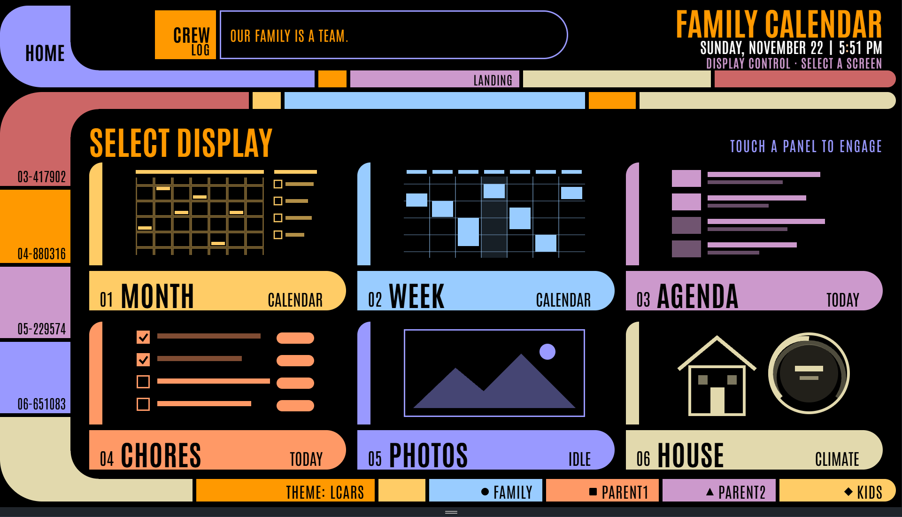
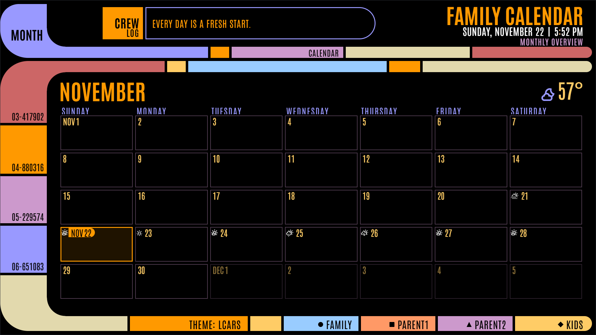

There's a screen in our kitchen that looks like it was pulled off the bridge of the *Enterprise-D*. It shows our family's calendars, the weather, the kids' chores and a rotating "crew log" of quotes and affirmations. You tap a panel to change screens, the same way the crew did on TV.

It's a Raspberry Pi, a touchscreen, and an open-source project called [MagicMirror²](https://github.com/MagicMirrorOrg/MagicMirror), wrapped in a theme I built to look like LCARS, the computer interface from *Star Trek: The Next Generation*. I've published it as [MMM-LCARS](https://github.com/hypnotoadie/MMM-LCARS) so anyone can build their own.

{fig-alt="An LCARS-style touchscreen showing six tiles labeled Month, Week, Agenda, Chores, Photos and House, framed by orange, purple and blue curved bars, with the title Family Calendar in the top right."}

## Why I built it

### I didn't want another subscription

Touchscreen family calendars are a whole product category now. They look nice, and they solve a real problem: a busy household needs one shared place to see who's going where. But most of them follow the same model. You buy the hardware, and then the most useful features sit behind a monthly subscription.

I didn't like the idea of paying every month to see my own calendar on my own wall. Our calendars already live in Google and Outlook, and both will hand you a private iCal link. All a display needs to do is read those links and draw them nicely. That's a job for a small computer I own, not a service I rent.

### I believe in open source

Most of my working life runs on open-source software, and I'm a big advocate for it. Open tools let you see how things work, fix what's broken and build on what other people have already figured out.

This project is a good example of that. MagicMirror² has a huge community of people writing modules for it. The month, week and agenda views use [MMRIZE](https://github.com/MMRIZE)'s CalendarExt3 modules. Page switching comes from MMM-pages, the chores board from MMM-Chores, and the photo slideshow from MMM-BackgroundSlideshow. Weather comes from [Open-Meteo](https://open-meteo.com/), which doesn't even need an API key. I wrote the LCARS frame, the home screen, the calendar filter and a handful of glue modules, but I was standing on a lot of other people's work the whole time.

So it felt right to give it back. The repo is MIT-licensed. Take it, change it, make it yours.

### I'm a huge Star Trek fan

I've loved the look of LCARS for as long as I've watched *The Next Generation*. The rounded "elbows," the bars of flat colour, the tall narrow type, the little blocks of meaningless numbers. Michael Okuda designed those screens to be cheap to produce and to feel like the future, and somehow they still do. Most "futuristic" interfaces from the late '80s look dated now. LCARS looks like a touchscreen app.

This fall I started watching TNG again from the beginning. Then, partway through, Patrick Stewart died. I miss him. Captain Picard was a model of a certain kind of leadership: calm, curious, principled, willing to listen to his crew and then make the call. Spending my evenings on the bridge with him made me want a little more of that world in the house. A family calendar where the info panel occasionally says "Make it so" or "Engage!" was the natural result.

{fig-alt="An LCARS-style month calendar for November with day boxes outlined in purple, today highlighted in orange, small weather icons on upcoming days, and four calendar legend pills along the bottom bar."}

## What it does

The full details are in the [README](https://github.com/hypnotoadie/MMM-LCARS#readme), but here's the short version:

- **Tap-driven pages.** A home screen with one panel per page: Month, Week, Agenda, Chores, Photos and House. Tap the header elbow on any page to go home. Nothing rotates on a timer, so the page you're reading doesn't change halfway through.
- **Three calendar views.** A month grid, a Sunday-to-Saturday week with a "now" line, and an agenda split into *Now*, *Later today* and *Coming up*.
- **A tappable calendar filter.** Pills along the bottom bar hide or show one person's calendar on every view, then reset after 30 minutes so nobody walks up to a half-empty screen.
- **A chores board** with one column per person. Kids tap a chore to tick it off.
- **A House page** (optional) with Nest thermostat controls and live camera feeds.
- **A weather chip** on every page that opens a 7-day and 12-hour forecast.

## A few design choices I'm happy with

**Colour *and* shape.** Each calendar has its own colour, but also its own marker: a circle, square, triangle or diamond. LCARS is a very colour-heavy design, and I didn't want the calendar to depend on colour alone. Anyone who has trouble telling peach from gold can still tell a square from a diamond.

**Everything is a tap.** MagicMirror was built for a mirror you look at, not a screen you touch. Most of my custom code is about turning it into something you interact with: the home tiles, the filter pills, the weather chip that opens a forecast and remembers which page to send you back to.

**Expensive things only run when you're looking.** Camera feeds are the biggest load on a Raspberry Pi. They only stream while the House page is open, and they pause after five minutes without a tap.

**The whole look is one class.** Every LCARS style in the CSS hangs off a single `theme-lcars` class on the page. That kept the theme in one place and makes it easy to add another theme later. (A Cardassian theme is tempting.)

## Things I learned along the way

**Your calendar's private link is a password.** The iCal "secret address" that Google and Outlook give you lets anyone who has it read your whole calendar. The repo ships with sample feeds and `CHANGE ME` markers, and the install steps *copy* the config instead of linking it, so your real links never end up in a git folder. If you build one of these, don't commit your real config to a public repo.

**Fixed layouts are a trade-off.** LCARS depends on precise geometry, so the layout uses fixed pixel positions for a 1920×1080 screen. That made the frame look right, but it means other resolutions need CSS work. I'm fine with that for a kitchen display; it would be the wrong call for a website.

**Frameworks have reserved words.** MagicMirror modules quietly break if you name your own properties `hidden`, `data`, `config`, `name` or `identifier`, or your methods `show`, `hide`, `init` or `stop`. Nothing errors. Things just stop working in confusing ways. That one cost me an evening.

**When a tap does nothing, something is on top of it.** With this many fixed-position layers, an invisible element covering a button was the usual culprit. Running `document.elementFromPoint(x, y)` in the browser's developer tools at the button's position tells you exactly what's catching the tap.

## Build your own

You'll need a Raspberry Pi 4 (or any machine running MagicMirror²), a 1920×1080 touchscreen and an afternoon. The [README](https://github.com/hypnotoadie/MMM-LCARS#readme) walks through installing the third-party modules, linking in the custom ones, plugging in your calendars and location, and, if you have Nest devices, setting up the House page. If you don't, it explains how to remove that page.

If you build one, I'd love to see it. And if you improve it, pull requests are welcome.

*This is a fan project. LCARS and Star Trek belong to their owners, and the project has no affiliation with them.*

Engage.
